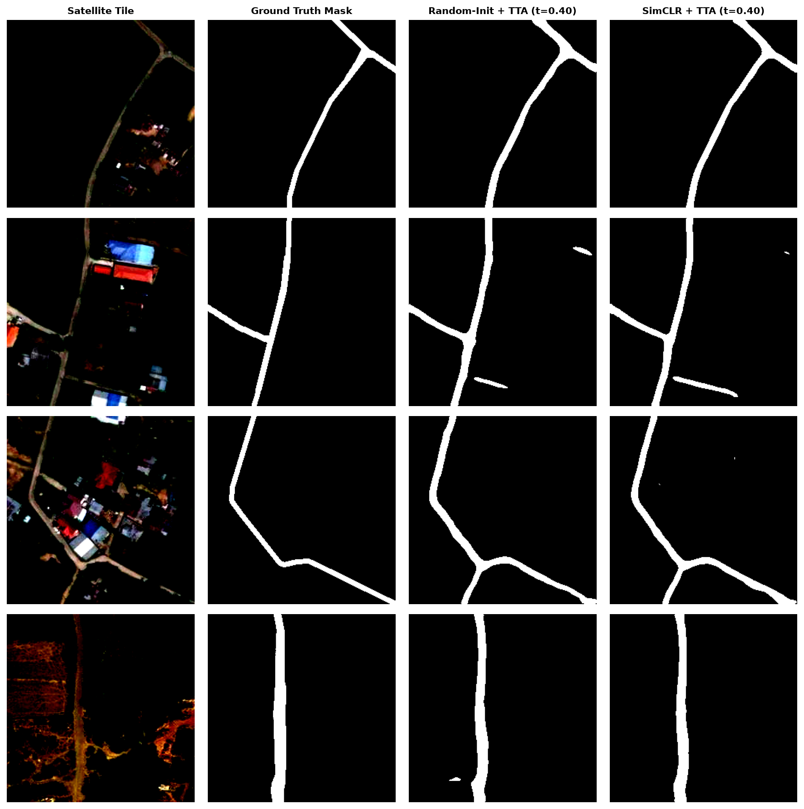

# Few-Shot Satellite Road Segmentation with SimCLR & U-Net

Pixel-level road extraction from high-resolution satellite imagery using **SimCLR self-supervised pre-training** followed by **few-shot U-Net fine-tuning** on the [DeepGlobe Road Extraction Dataset](http://deepglobe.org/). Full methodology, ablations, and qualitative analysis are detailed in the accompanying **[Technical Report (PDF)](paper/Few_Shot_Satellite_Road_Extraction_SimCLR_TTA.pdf)**.

Annotating road networks at pixel precision is slow and expensive, whereas raw satellite imagery is abundant. This repository tests how far contrastive pre-training on unlabeled aerial tiles can push downstream segmentation accuracy when only **1% (471 tiles)** or **5% (2,355 tiles)** of labeled masks are available.

---

## Architecture & Pipeline

The codebase is structured as a two-stage PyTorch pipeline using mixed-precision (`torch.amp`) training on a single GPU (tested on an NVIDIA RTX 2070 SUPER 8 GB):

1. **Tile Preparation (`prepare_data.py`)**
   - Slices $1024 \times 1024$ DeepGlobe satellite scenes into $256 \times 256$ patches with strict scene-level train/validation splitting (`0` parent-scene overlap) to prevent spatial or transductive data leakage.
   - Builds a pool of **122,176 unlabeled tiles** (`7,636` scenes) for self-supervised pre-training, **47,104 labeled training tiles** (subsampled to 1% and 5% at `seed=42`), and **8,343 validation tiles** (`934` disjoint scenes).
2. **Stage 1 — Contrastive Pre-Training (`train_ssl.py`, `models.py`)**
   - Trains a **ResNet-18** backbone with a 2-layer MLP projection head ($512 \rightarrow 512 \rightarrow 128$) via **NT-Xent (SimCLR) loss** ($\tau = 0.2$) using multi-view satellite augmentations (random resized crops, flips, color jitter, grayscale, and Gaussian blur).
3. **Stage 2 — Few-Shot U-Net Fine-Tuning (`train_seg.py`, `model_unet.py`)**
   - Transfers the pre-trained ResNet-18 encoder into a **U-Net decoder** with skip connections (`conv1` through `layer4`) and fine-tunes end-to-end with an equally weighted composite **0.5 BCE + 0.5 Soft Dice loss** on 1% and 5% labeled splits against a randomly initialized baseline.
4. **Evaluation & Test-Time Augmentation (`eval_tta.py`, `visualize.py`)**
   - Evaluates checkpoints across all `8,343` validation tiles using **4x Test-Time Augmentation (TTA)** ($\{I, \text{Flip}_H, \text{Flip}_V, \text{Rot}_{90^\circ}\} \subset D_4$) at both fixed $t=0.50$ and row-wise calibrated thresholds (`0.30`–`0.65`).

---

## Experimental Results (`8,343` Validation Tiles)

| Labeled Split        | Initialization                         | Unlabeled Pre-Training     | Eval Mode   |   Thr.   |  Val IoU   |  Val Dice  | Δ IoU (pp) |
| :------------------- | :------------------------------------- | :------------------------- | :---------- | :------: | :--------: | :--------: | :--------: |
| **1% (471 tiles)**   | Random-Init U-Net                      | None                       | Single-pass |   0.50   |   34.80%   |   51.63%   |     —      |
| **1% (471 tiles)**   | Random-Init + 4x TTA (Cal.)\*,†        | None                       | 4x TTA      |   0.50   |   36.35%   |   53.32%   |   +1.55    |
| **1% (471 tiles)**   | SimCLR (Subset)                        | 10,000 tiles (10 ep.)      | Single-pass |   0.50   |   38.93%   |   56.05%   |   +4.13    |
| **1% (471 tiles)**   | SimCLR (Full Pool)                     | 122,176 tiles (15 ep.)     | Single-pass |   0.50   |   42.31%   |   59.46%   |   +7.51    |
| **1% (471 tiles)**   | SimCLR (Full Pool) + 4x TTA            | 122,176 tiles (15 ep.)     | 4x TTA      |   0.50   |   44.51%   |   61.60%   |  +8.16\*   |
| **1% (471 tiles)**   | **SimCLR (Full Pool) + 4x TTA (Cal.)** | **122,176 tiles (15 ep.)** | **4x TTA**  | **0.55** | **44.86%** | **61.94%** | **+8.51†** |
| **5% (2,355 tiles)** | Random-Init U-Net                      | None                       | Single-pass |   0.50   |   49.33%   |   66.07%   |     —      |
| **5% (2,355 tiles)** | Random-Init + 4x TTA\*                 | None                       | 4x TTA      |   0.50   |   50.11%   |   66.77%   |   +0.78    |
| **5% (2,355 tiles)** | Random-Init + 4x TTA (Cal.)†           | None                       | 4x TTA      |   0.40   |   50.37%   |   67.00%   |   +1.04    |
| **5% (2,355 tiles)** | SimCLR (Subset)                        | 10,000 tiles (10 ep.)      | Single-pass |   0.50   |   50.92%   |   67.48%   |   +1.59    |
| **5% (2,355 tiles)** | SimCLR (Full Pool)                     | 122,176 tiles (15 ep.)     | Single-pass |   0.50   |   52.06%   |   68.47%   |   +2.73    |
| **5% (2,355 tiles)** | SimCLR (Full Pool) + 4x TTA            | 122,176 tiles (15 ep.)     | 4x TTA      |   0.50   |   53.03%   |   69.31%   |  +2.92\*   |
| **5% (2,355 tiles)** | **SimCLR (Full Pool) + 4x TTA (Cal.)** | **122,176 tiles (15 ep.)** | **4x TTA**  | **0.40** | **53.27%** | **69.51%** | **+2.90†** |

> Single-pass models are evaluated at fixed $t=0.50$ and compared against `Random-Init U-Net`. TTA models are compared against `Random-Init + 4x TTA` (`*`) at fixed $t=0.50$ and against `Random-Init + 4x TTA (Cal.)` (`†`) after row-wise validation threshold calibration (on 1%, $t=0.50$ was also the calibrated optimum for `Random-Init + 4x TTA`).

### Key Takeaways

- **Strongest gains in the extreme low-label regime:** At fixed $t=0.50$ on 1% labels (`471` tiles), full-pool SimCLR improves validation IoU by **+7.51 percentage points** (`34.80% → 42.31%`, `+21.6%` relative), reaching **44.51% IoU** (`+8.16 pp` over fixed-threshold TTA baseline) with 4x TTA and **44.86% IoU** (`+8.51 pp`) after threshold calibration.
- **Data scale matters in Stage 1:** Expanding SimCLR pre-training from 10k tiles (final NT-Xent loss `2.2919`) to all 122,176 tiles (final NT-Xent loss `1.5309`) adds **+3.38 percentage points IoU** on 1% labels and **+1.14 percentage points IoU** on 5% labels at fixed $t=0.50$.
- **Possible annotation omissions:** Qualitative inspection shows the pre-trained model appears to trace visually plausible unpaved dirt tracks omitted from crowd-sourced DeepGlobe ground-truth masks, which can penalize raw pixel IoU while producing more complete road topologies.

---

## Qualitative Comparison (5% Labeled Split)



---

## Repository Structure

```text
.
├── paper/
│   └── Few_Shot_Satellite_Road_Extraction_SimCLR_TTA.pdf  # Full CVPR-style technical report
├── dataset.py          # PyTorch Dataset classes for SimCLR pairs and segmentation masks
├── prepare_data.py     # Scene-level splitting and 256x256 tile extraction
├── models.py           # ResNet-18 encoder + SimCLR projection head
├── model_unet.py       # ResNet-18 U-Net architecture with skip connections
├── train_ssl.py        # Stage 1 self-supervised SimCLR training loop
├── train_seg.py        # Stage 2 few-shot U-Net training & validation loop
├── visualize.py        # Standard single-pass comparison grid generator
├── eval_tta.py         # 4x Test-Time Augmentation + threshold sweep evaluator
└── results/            # Comparison plots (binary .pt checkpoints excluded via .gitignore)
    ├── 01_subset_10k_pretrain/   # 10k-tile SimCLR comparison plots
    ├── 02_full_122k_pretrain/    # Full 122,176-tile SimCLR single-pass grids
    └── 03_full_122k_tta_eval/    # 4x TTA + threshold-calibrated evaluation grids
```

---

## Setup & Replication Instructions

### 1. Environment Setup

Create a virtual environment, activate it, and install the required packages:

```bash
python -m venv .venv

# Windows PowerShell:
Set-ExecutionPolicy -Scope Process -ExecutionPolicy RemoteSigned
.\.venv\Scripts\Activate.ps1

# Linux / macOS:
# source .venv/bin/activate

pip install torch torchvision numpy pillow matplotlib
```

### 2. Prepare Dataset Tiles

Download the DeepGlobe Road Extraction dataset into `raw_deepglobe/` and slice the scenes into $256 \times 256$ tiles:

```bash
python -u prepare_data.py --raw_dir raw_deepglobe --out_dir data
```

This creates `data/unlabeled/`, `data/train/images/`, `data/train/masks/`, `data/val/images/`, and `data/val/masks/`.

### 3. Train Random-Initialization Baselines

Train supervised U-Net models from scratch on 1% (`471` tiles) and 5% (`2,355` tiles) labeled splits as reference baselines:

```bash
python -u train_seg.py --fraction 0.01 --epochs 15 --out results/01_subset_10k_pretrain/unet_rand_1pct.pt
python -u train_seg.py --fraction 0.05 --epochs 15 --out results/01_subset_10k_pretrain/unet_rand_5pct.pt
```

### 4. Case A — Subset SimCLR Pre-Training (`10,000` Unlabeled Tiles)

Run a fast proof-of-concept pre-training on a 10,000-tile subset (~25 minutes on RTX 2070 SUPER), fine-tune on 1% and 5% labels, and render comparison figures:

```bash
# Stage 1: SimCLR pre-training on 10k tiles
python -u train_ssl.py --data_dir data/unlabeled --epochs 10 --batch_size 128 --max_samples 10000 --out results/01_subset_10k_pretrain/encoder_ssl.pt

# Stage 2: Fine-tune U-Net on 1% and 5% labeled splits
python -u train_seg.py --fraction 0.01 --ssl_weights results/01_subset_10k_pretrain/encoder_ssl.pt --epochs 15 --out results/01_subset_10k_pretrain/unet_ssl_1pct.pt
python -u train_seg.py --fraction 0.05 --ssl_weights results/01_subset_10k_pretrain/encoder_ssl.pt --epochs 15 --out results/01_subset_10k_pretrain/unet_ssl_5pct.pt

# Stage 3: Generate side-by-side validation mask comparisons
python -u visualize.py --rand_weights results/01_subset_10k_pretrain/unet_rand_1pct.pt --ssl_weights results/01_subset_10k_pretrain/unet_ssl_1pct.pt --out results/01_subset_10k_pretrain/comparison_1pct.png
python -u visualize.py --rand_weights results/01_subset_10k_pretrain/unet_rand_5pct.pt --ssl_weights results/01_subset_10k_pretrain/unet_ssl_5pct.pt --out results/01_subset_10k_pretrain/comparison_5pct.png
```

### 5. Case B — Full-Scale SimCLR Pre-Training (`122,176` Unlabeled Tiles)

Scale Stage 1 across all 122,176 unlabeled tiles (~4.5 hours on RTX 2070 SUPER), transfer the encoder to 1% and 5% labeled splits, and evaluate at the default `0.50` probability threshold:

```bash
# Stage 1: Full-scale SimCLR pre-training across all 122,176 tiles
python -u train_ssl.py --data_dir data/unlabeled --epochs 15 --batch_size 128 --max_samples 150000 --out results/02_full_122k_pretrain/encoder_ssl_full.pt

# Stage 2: Fine-tune U-Net on 1% and 5% labeled splits
python -u train_seg.py --fraction 0.01 --ssl_weights results/02_full_122k_pretrain/encoder_ssl_full.pt --epochs 15 --out results/02_full_122k_pretrain/unet_ssl_full_1pct.pt
python -u train_seg.py --fraction 0.05 --ssl_weights results/02_full_122k_pretrain/encoder_ssl_full.pt --epochs 15 --out results/02_full_122k_pretrain/unet_ssl_full_5pct.pt

# Stage 3: Generate standard (t=0.50) comparison grids
python -u visualize.py --rand_weights results/01_subset_10k_pretrain/unet_rand_1pct.pt --ssl_weights results/02_full_122k_pretrain/unet_ssl_full_1pct.pt --out results/02_full_122k_pretrain/comparison_full_1pct.png
python -u visualize.py --rand_weights results/01_subset_10k_pretrain/unet_rand_5pct.pt --ssl_weights results/02_full_122k_pretrain/unet_ssl_full_5pct.pt --out results/02_full_122k_pretrain/comparison_full_5pct.png
```

### 6. Case C — 4x Test-Time Augmentation & Threshold Sweep

Evaluate the trained full-scale models across all 8,343 validation tiles using 4-orientation TTA and probability threshold calibration (`0.30`–`0.65`) without retraining:

```bash
python -u eval_tta.py --rand_weights results/01_subset_10k_pretrain/unet_rand_1pct.pt --ssl_weights results/02_full_122k_pretrain/unet_ssl_full_1pct.pt --out results/03_full_122k_tta_eval/comparison_tta_1pct.png
python -u eval_tta.py --rand_weights results/01_subset_10k_pretrain/unet_rand_5pct.pt --ssl_weights results/02_full_122k_pretrain/unet_ssl_full_5pct.pt --out results/03_full_122k_tta_eval/comparison_tta_5pct.png
```

---

## Author

**Spyridon Mouroutis** — Electrical & Computer Engineering, Technical University of Crete
